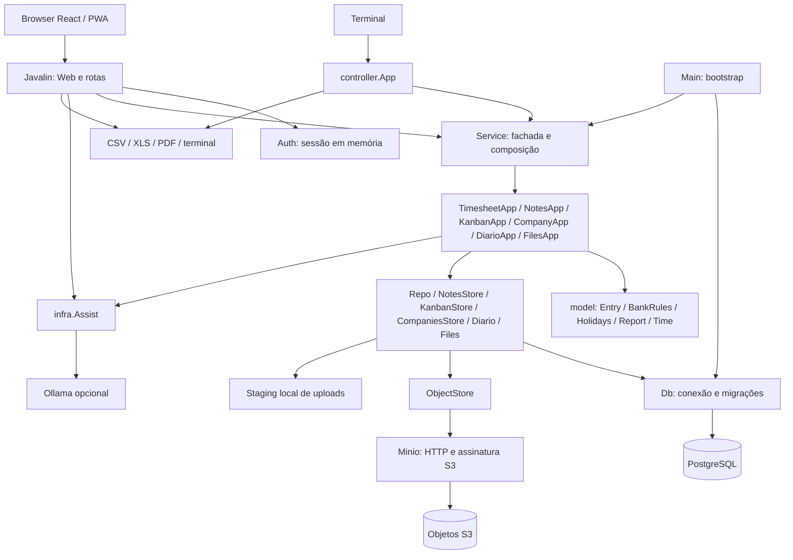
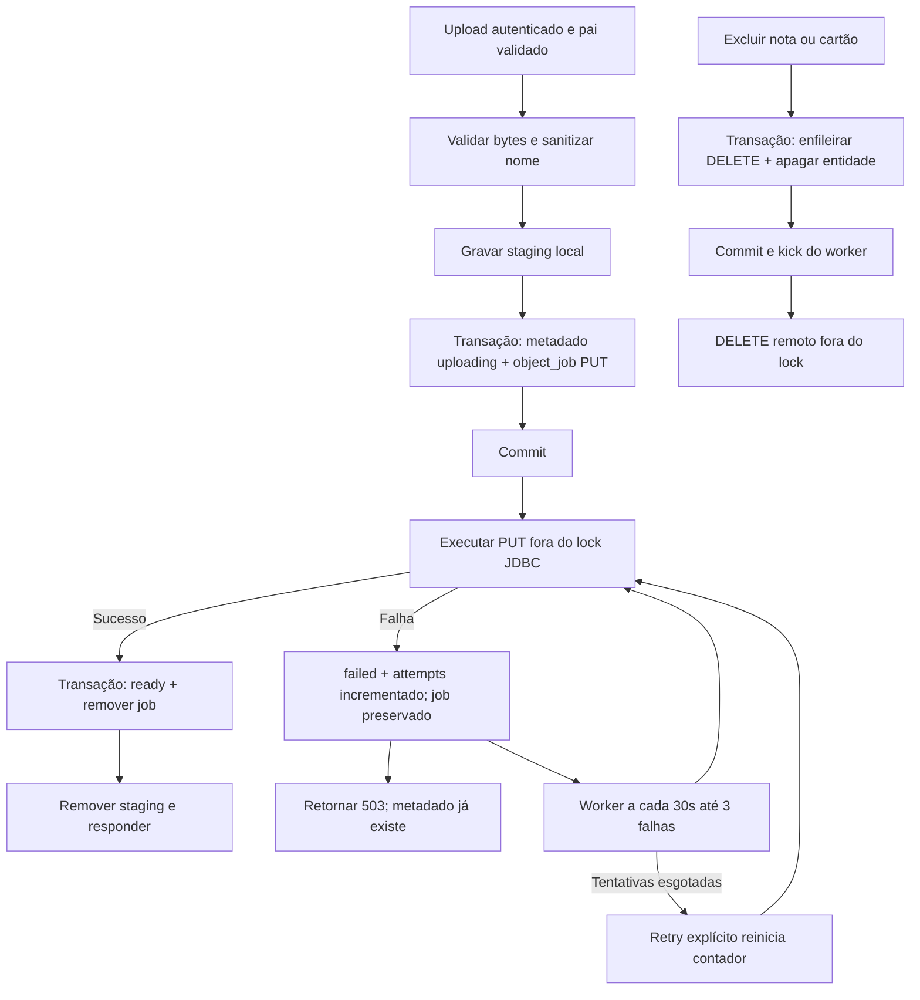

# Análise Arquitetural
**Data de geração:** 2026-11-15
**Gerado por:** Agent Devin

## Escopo e método

Análise do checkout `/Users/thiagohmm/ponto`, referência Git `5bd81e2`. Foram inspecionados código Java, frontend TypeScript/React, esquema SQL, testes, build, CI, contêineres e automação de backup/deploy. O diagnóstico descreve o comportamento implementado; comentários e README foram tratados como contexto, não como prova de execução.

Não houve alteração de código funcional, execução de deploy, acesso a produção ou leitura de credenciais reais. Não foram executados testes nesta análise documental. Os resultados em `target/surefire-reports` são artefatos preexistentes: nove suítes, 40 testes, sem falhas, erros ou skips registrados; isso não comprova que o checkout atual passe novamente. Os cenários de defeito abaixo são deduções verificáveis do código, sem reprodução dinâmica nesta sessão. Não foi realizada auditoria jurídica do calendário.

## 1. Visão geral da arquitetura descoberta

### Estilo e contexto

O Ponto é um **monólito em camadas, com organização parcial por capacidades**, distribuído como um único JAR Java 25. Possui interface de terminal e API HTTP Javalin, que também serve o build React. Usa PostgreSQL via JDBC, armazenamento de objetos compatível com S3/MinIO e assistência opcional via Ollama.

Há elementos de Clean Architecture — políticas puras, fachada compartilhada e uma porta `ObjectStore` — mas a direção de dependências não segue Clean/Hexagonal de forma consistente. `app` instancia e importa `infra`; `CompaniesStore` importa `app.Service`; controllers de assistência conhecem `infra.Assist`. O modelo é predominantemente composto por records e utilitários, com algumas políticas explícitas. Não há agregados DDD ricos nem limites de contexto formalizados. Empresas são partições dos dados de um usuário, não tenants com autorização independente.

### Estrutura e responsabilidades

| Diretório | Responsabilidade observada |
|---|---|
| `src/main/java/ponto/` | `Main`, health check, versão e exceções da aplicação. |
| `ponto/controller/` | Menu CLI, rotas HTTP, autenticação, parsing e composição das respostas. |
| `ponto/app/` | Fachada `Service`, APIs por capacidade, regras de ponto/banco e orquestração do diário/anexos. |
| `ponto/model/` | Records de dados, duração, calendário, parsing, relógio e política de saldo. |
| `ponto/infra/` | JDBC, esquema/migrações, stores com SQL e regras, fila de objetos, cliente S3 e Ollama. |
| `ponto/view/` | Entrada/saída CLI, serialização JSON e exportação CSV/XLS/PDF. |
| `src/main/resources/public/` | HTML de origem legado; o Maven exclui esse diretório dos recursos publicados. |
| `web/src/` | SPA, providers de autenticação/empresa, páginas, hooks, editor e cliente API. |
| `web/public/` | Manifesto, ícones, tema e service worker. |
| `test/` | JUnit, fixtures, smoke CLI e testes Python de backup. Não segue `src/test/java`, mas está configurado no POM. |
| `web/test/`, `web/e2e/` | Vitest/Testing Library e Playwright. |
| `deploy/` | Build validado, envio SSH, instalação remota, backup, restauração e smoke operacional. |
| `.github/workflows/` | Pipeline que prepara PostgreSQL e executa verificações backend/frontend/backup/E2E. |
| `target/`, `web/dist/` | Artefatos gerados; não são a fonte da arquitetura. |

### Injeção de dependência e dados

1. `Main.main` resolve argumentos, abre `Db` e constrói `new Service(d)` para CLI ou web.
2. `Db.open` abre **uma conexão JDBC**, configura sessão e executa migrações. Todos os contextos de empresa compartilham conexão e `lock`.
3. `Service(Db)` é fachada e ponto de composição: cria `CompanyApp`, `NotesApp`, `KanbanApp`, `FilesApp`, `TimesheetApp` e `DiarioApp`, bem como seus stores concretos.
4. `TimesheetApp` recebe suppliers de empresa/usuário, mas cria `Repo` e `Reports`. Não há container de DI nem interfaces de repositório.
5. No HTTP, `Web.before` valida autenticação e `companyId`, cria `Service.forCompany(id)` e o coloca no contexto da requisição. `Db.forCompany` fixa o identificador sem trocar o estado global da CLI. `FilesApp.adopt` compartilha worker/storage entre escopos.
6. No browser, `CompanyProvider` mantém seleção por aba em `sessionStorage`; `api.ts` acrescenta `companyId` nas URLs. As páginas remontam por empresa na composição da interface.
7. Respostas combinam records de aplicação, `view.Json` e mapas sem tipo. DTOs Java e tipos TypeScript são mantidos manualmente.



O diagrama representa chamadas/dependências reais, incluindo os atalhos para infraestrutura. A existência de pastas em camadas não significa inversão das dependências.

## 2. Mapeamento de responsabilidades e regras de negócio

| Arquivo/módulo | Responsabilidade | Regra de negócio / comportamento |
|---|---|---|
| `model/Entry.java` | Representar uma linha de ponto | Sem horários é justificativa; um horário é aberto; dois são fechados; duração noturna soma 24h. |
| `app/TimesheetApp.java` | Registrar/editar pontos e calcular banco | Impede horários iguais; pede confirmação de virada e sobreposição; pode fechar a única entrada aberta do dia. |
| `model/BankRules.java` | Política diária de saldo | Falta desconta jornada; folga credita trabalho; dia sem batida não cria débito automático; tolerância de cinco minutos. |
| `model/Holidays.java` | Calendário e folgas pessoais | Fins de semana, datas fixas/móveis e folgas configuradas são dias off; não impedem registrar trabalho. |
| `app/Service.java` | Fachada, configuração e coordenação | Jornada padrão de 8h; interpreta jornada; exclusões de notas/cartões incluem intenção de apagar objetos. |
| `infra/CompaniesStore.java` | Empresas e configuração por empresa | Nome obrigatório; cria colunas iniciais; impede apagar última empresa ou empresa com pontos/notas/cartões. |
| `infra/NotesStore.java` | Notas, árvore e tags | Revisão otimista; evita ciclos de pasta; exclusão de pasta promove filhos; pesquisa exige todos os termos. |
| `infra/KanbanStore.java` | Quadro, ordenação e impedimentos | Bloqueio exige categoria/motivo; cartão bloqueado não vai para Feito; mantém episódios de bloqueio. |
| `infra/Files.java` | Anexos e consistência com S3 | Valida tamanho/nome; grava intenção durável; só baixa quando ready; limita tentativas automáticas. |
| `app/DiarioApp.java`, `infra/Diario.java` | Consolidar atividade diária | Agrega pontos/notas/cartões/bloqueios e salva um resumo por empresa/data. |
| `infra/Assist.java`, `model/JustCategory.java` | Sugestões opcionais | Categorias não alteram saldo; tags sugeridas são filtradas pelos IDs fornecidos; fallback permite funcionar sem modelo. |
| `controller/Auth.java` | Acesso web individual | Credenciais de ambiente, sessão deslizante de sete dias e limite de falhas de login por IP. |
| `model/Report.java`, `infra/Reports.java`, `view/*` | Consolidar e exportar | Soma pares completos, ordena linhas e preserva saldo calculado pela aplicação. |

### R1. Registro e fechamento de ponto

`TimesheetApp.create` rejeita uma criação totalmente vazia. Uma linha apenas com justificativa é válida. Entradas abertas são permitidas; o fluxo rápido do frontend cria entrada com justificativa vazia. Se `closeOpen=true`, houver exatamente uma linha com entrada e sem saída no mesmo dia e uma saída for fornecida, a operação fecha essa linha, preservando entrada e justificativa originais. Se a condição não se verificar, o método segue para criação de outra linha; ele não rejeita explicitamente a ambiguidade. A interface rápida restringe situações ambíguas, mas essa proteção não é uma invariante do backend.

`inspectLocked` compara horários completos com outras linhas **da mesma data**. Horários iguais são rejeitados por `assertOk`. Saída anterior à entrada representa virada de dia, e sobreposição requer confirmação explícita. `NeedConfirm` vira HTTP 409 com código `midnight` ou `overlap`; o cliente pergunta e reenvia. Intervalos adjacentes não são sobreposição. Como não há leitura do dia anterior/seguinte, uma jornada noturna pode sobrepor uma batida da manhã seguinte sem aviso.

Na edição, uma linha aberta sem justificativa é rejeitada, embora a criação permita isso. O record `Entry` isolado não garante essas invariantes: `min()` trata até horários iguais como 24h; são os serviços que impedem esse caso. Toda a duração fica atribuída à data inicial, inclusive quando cruza meia-noite.

### R2. Banco de horas

Trecho central de `BankRules.day`:

```java
if (falta) return worked - daily;
if (!normal && off) return worked;
if (!hasPunch) return 0;
long raw = worked - daily;
return Math.abs(raw) <= TOLERANCE_MINS ? 0 : raw;
```

Com jornada de 480 minutos: 477 minutos em dia normal produzem saldo zero; 470 produzem -10; 60 em folga produzem +60; falta sem trabalho produz -480. A tolerância não se aplica ao ramo de falta. Dia útil sem par completo não gera falta automaticamente: a marcação de falta é explícita. `dayMins` considera somente pares fechados com duração positiva, não justificativas soltas nem linhas abertas.

`saldoBetween` encerra o cálculo em hoje, desconsiderando datas futuras. `bank` distribui o saldo a compensar pelos dias restantes elegíveis, incluindo hoje, arredonda minutos e força pelo menos um minuto quando há saldo não nulo. Isso é uma sugestão operacional, não alteração de registros. Folgas e faltas reduzem os dias disponíveis; `normal` torna uma folga elegível.

O SQL permite **uma flag por empresa/dia**, pois a chave é `(company_id,dia)`. Marcar `normal` substitui `falta`, e vice-versa. A precedência da falta existe na política pura, mas os avisos que sugerem coexistência não correspondem ao estado persistível normal.

### R3. Calendário, jornada e configuração

`Holidays` calcula datas móveis pela Páscoa e combina calendário fixo com folgas da empresa. `off()` retorna texto português, usado também para decidir se há folga. Datas facultativas e até a descrição “Quarta-feira de Cinzas (até 12h)” entram como **dia inteiro off**, pois a política recebe apenas um booleano. Trabalhar em off é permitido e pode gerar crédito integral.

O código inclui 26/12 como “Confraternização Universal”, além de 01/01, e aplica datas adicionais a todos os anos. Isso é uma configuração efetivamente implementada, inclusive afirmada em teste; sua adequação ao calendário desejado precisa ser validada pelo responsável pelo produto. O comentário de que falha de calendário “só esconde aviso” está desatualizado: o calendário alimenta `BankRules` e afeta saldo.

`Service.parseDailyMins` aceita horas decimais ou `h:mm`, entre 30 e 1440 minutos, com padrão 480. `CompaniesStore` salva horas decimais por `dailyLabel`, com duas casas, e a leitura reconverte para minutos arredondados; a representação exige conversões, embora essa precisão seja suficiente para recuperar os minutos inteiros no intervalo aceito. `offDates` usa o parser geral de datas e ignora tokens inválidos com callback opcional; folgas sem ano são interpretadas em função do relógio, não modeladas como recorrência explícita. Usuário (`who`) e seleção padrão CLI ficam em `cfg` global; jornada e folgas ficam na empresa.

### R4. Empresas e isolamento

Listagens e alterações de pontos/notas/cartões usam `company_id`; pastas e colunas contam com FKs compostas. O vínculo nota-tag é protegido também por trigger. `Service.forCompany` valida existência e cria um contexto fixo, evitando que a seleção de uma aba troque o contexto de outra.

`CompaniesStore.delete` exige mais de uma empresa e ausência de pontos, notas e cartões. Apaga colunas, pastas, tags e flags, atualizando seleção global se necessário. **Não trata `day_digest`**, cuja FK bloqueia apagar uma empresa que só tenha resumos persistidos. O catálogo de empresas é global e não há ACL por empresa: isso é coerente com uso individual, mas não oferece isolamento de autorização entre usuários.

### R5. Notas, pastas, tags e pesquisa

Criação da nota e vínculos de tags são transacionais. Nota, pasta e tags devem pertencer à empresa atual. A edição de conteúdo exige `revision`: o SQL atualiza somente a revisão informada e a incrementa; caso contrário retorna conflito, preservando o texto mais novo.

Mover uma pasta valida o destino e percorre ancestrais para impedir ciclos. Apagar pasta move notas e subpastas para o pai ou raiz dentro de transação. Criar tag reaproveita nome igual sem distinguir maiúsculas; renomear não aplica a mesma deduplicação e não existe restrição única para isso. Cores válidas são hexadecimais de seis dígitos, com fallback em paleta.

Pesquisa de notas combina título, corpo, nomes de tags e anexos; cada palavra adiciona um `AND`, usando normalização de caixa/acentos. O SQL usa `LIKE` sem escape de `%`/`_`, logo esses caracteres têm semântica de wildcard, não de busca literal. O frontend também possui matcher local, criando dois lugares para manter a semântica.

### R6. Kanban

Empresas recebem “A fazer”, “Em andamento” e “Feito”. A proteção contra exclusão depende do **nome normalizado**, não de um tipo imutável. `updateColumn` permite renomear essas colunas, de modo que o comportamento de proteção/conclusão muda com o texto.

`moveCard` valida origem/destino e limita a posição ao tamanho da lista, reordenando o destino e a origem em transação. Edição de título/corpo/`done` usa revisão otimista; movimento e bloqueio não incrementam essa revisão. `done` é texto livre e é independente da coluna “Feito”.

Bloqueio rejeita cartão em Feito, bloqueio já aberto, tipo inválido e motivo vazio ou acima de 500 caracteres. Um índice único parcial impede dois bloqueios abertos. Desbloqueio registra `cleared`, preservando histórico. Cartão bloqueado pode mudar para outras colunas, mas não para Feito. Apesar de comentário mencionar “Em andamento”, `blockCard` permite qualquer coluna que não seja Feito.

### R7. Anexos e consistência eventual

`Files.stage` exige S3 configurado, conteúdo não vazio e limite entre 1–100 MiB configuráveis (padrão 20). Remove diretórios e caracteres de controle do nome; gera chave com UUID e salva bytes em staging local.

Metadados com `state=uploading` e job `PUT` são gravados na mesma transação. A transferência ocorre fora do lock do banco. Sucesso muda para `ready` e remove job/staging; falha marca `failed`, incrementa tentativas e mantém intenção e bytes. Há processamento periódico a cada 30 segundos; ao chegar a três falhas, só retry explícito reinicia as tentativas. O upload pode retornar 503 depois de já persistir metadados; o cliente deve recarregar a lista, evitando reenviar e duplicar anexos.

Exclusão de nota/cartão pela fachada salva jobs `DELETE` antes da cascata, na mesma transação. O worker trata exclusão concorrente a upload preservando a intenção mais recente. Download exige `ready` e confere tamanho do objeto. As rotas verificam o pai e o vínculo do arquivo; o componente `Files` e os métodos públicos da fachada não aplicam esse escopo por si mesmos.

### R8. Diário e assistência

`Diario.snapshot` junta batidas da data, notas/cartões criados ou com último `upd` naquela data, episódios de bloqueio, timeline e métricas visuais. Não é um log de auditoria: alterações intermediárias desaparecem quando `upd` avança, exclusões removem conteúdo e mover cartão não atualiza `upd`.

`DiarioApp.gerarResumo` monta fatos, pede resumo à assistência e faz upsert em `(company_id,dia)`, salvando texto, fatos e modelo, ou `fallback`. Não modifica pontos nem saldo. Os fatos persistidos dão rastreabilidade do insumo, mas o resumo não é invalidado quando os dados mudam depois.

Sugestões de justificativa usam catálogo finito e fallback; categorias são apenas UX. Tags sugeridas são filtradas pelos IDs fornecidos. `AssistRoutes` retorna sugestões sem gravar notas. Ollama é opcional e tem timeouts; o resumo tem timeout de até 30 segundos, atualmente dentro do lock global da fachada.

### R9. Acesso, exportação e operação

`Auth.fromEnv` habilita autenticação quando ambas as credenciais estão presentes e rejeita configuração parcial; sem ambas, permite acesso aberto. `Web.start` escuta em `0.0.0.0`. O Compose exige credenciais, mas iniciar diretamente o JAR sem elas expõe o modo aberto.

Sessão usa token aleatório de 32 bytes, cookie HttpOnly/SameSite=Lax e validade de sete dias, renovada no servidor ao acessar. Cinco falhas de login em um minuto bloqueiam novas tentativas por IP. Sessões são locais ao processo; reinício encerra acesso. Cabeçalhos de proxy influenciam IP e Secure, portanto exigem fronteira de proxy confiável. Não há modelo de papéis.

`Report` soma apenas minutos completos e conta linhas parcialmente preenchidas como abertas; algumas totalizações da aplicação contam qualquer linha não fechada, incluindo justificativa pura. CSV usa BOM/separador configurável; XLS usa POI HSSF; PDF usa PDFBox. Exportação web cria arquivo temporário e devolve bytes; intervalo sem linhas é recusado, mesmo que tenha apenas falta e saldo negativo.

O PWA armazena a casca/assets e mantém `/api/` na rede: não há cache de dados de negócio nem fila de gravação offline. Backup operacional para aplicação/MinIO, gera `pg_dump`, arquiva objetos e staging, verifica hashes e aplica retenção. A consistência pressupõe parar todos os escritores, inclusive CLI/processos externos.

## 3. Arquivos relevantes analisados

Os caminhos abaixo são absolutos, a partir do checkout analisado. Os resumos identificam trechos por símbolo, para evitar depender de linhas que mudem após refatorações.

| Caminho completo | Responsabilidade e trecho relevante | Regras |
|---|---|---|
| `/Users/thiagohmm/ponto/src/main/java/ponto/Main.java` | `main`: abre `Db`, constrói `Service`, seleciona CLI/servidor/check de banco. | Bootstrap de R9. |
| `/Users/thiagohmm/ponto/src/main/java/ponto/controller/App.java` | Menu interativo, coleta campos, confirma avisos e chama fachada/exportadores. | Adapta R1–R3 e R9 ao terminal. |
| `/Users/thiagohmm/ponto/src/main/java/ponto/controller/Web.java` | `application`, `service`, `create`, `update`, `list`, `write`: middleware, rotas de ponto, respostas e exportação. | R1, R4, R9; 409 para confirmação/conflito. |
| `/Users/thiagohmm/ponto/src/main/java/ponto/controller/Auth.java` | `fromEnv`, `login`, `open`, `client`, `secure`: credenciais, rate limit e cookie. | R9. |
| `/Users/thiagohmm/ponto/src/main/java/ponto/controller/NoteRoutes.java` | `folderUpdate` coordena rename/move em transação; `fileUpload/fileDownload` validam pai e vínculo. | R5 e R7. |
| `/Users/thiagohmm/ponto/src/main/java/ponto/controller/KanbanRoutes.java` | CRUD, movimento, bloqueio e anexos com parsing HTTP. | R6–R7. |
| `/Users/thiagohmm/ponto/src/main/java/ponto/controller/AssistRoutes.java` | `noteTags`/`just`: chama infraestrutura e devolve sugestões. | R8. |
| `/Users/thiagohmm/ponto/src/main/java/ponto/controller/DiarioRoutes.java` | Adapta leitura e geração de resumo por data à API. | R8. |
| `/Users/thiagohmm/ponto/src/main/java/ponto/app/Service.java` | Construtor, `forCompany`, `deleteNote/deleteKanbanCard/deleteKanbanColumn`, `gerarResumoDiario`, `parseDailyMins`. | Coordena R1–R8; contém composição, regras e configuração. |
| `/Users/thiagohmm/ponto/src/main/java/ponto/app/TimesheetApp.java` | `inspectLocked/assertOk/create/update`, `saldoBetween/bank/bankDays/filteredRange`. | R1–R3; calendário e política de saldo. |
| `/Users/thiagohmm/ponto/src/main/java/ponto/app/CompanyApp.java` | Delega empresa ao store concreto; pouca lógica adicional. | R4 fica principalmente no store. |
| `/Users/thiagohmm/ponto/src/main/java/ponto/app/NotesApp.java` | API fina sobre NotesStore. | Encaminha R5. |
| `/Users/thiagohmm/ponto/src/main/java/ponto/app/KanbanApp.java` | API fina sobre KanbanStore. | Encaminha R6. |
| `/Users/thiagohmm/ponto/src/main/java/ponto/app/FilesApp.java` | `raw/adopt`: criação lazy e compartilhamento de worker/storage. | Ciclo de vida de R7. |
| `/Users/thiagohmm/ponto/src/main/java/ponto/app/DiarioApp.java` | `gerarResumo`: snapshot → fatos → IA/fallback → upsert. | R8. |
| `/Users/thiagohmm/ponto/src/main/java/ponto/model/Entry.java` | `empty/open/closed/min`: estados e duração de uma linha. | R1. |
| `/Users/thiagohmm/ponto/src/main/java/ponto/model/BankRules.java` | `day`: política pura reproduzida na seção 2. | R2. |
| `/Users/thiagohmm/ponto/src/main/java/ponto/model/Holidays.java` | `off/year/of/MISSING`: calendário em Java com folgas via supplier. | R3; rótulos usados como dados de decisão. |
| `/Users/thiagohmm/ponto/src/main/java/ponto/model/Parse.java` | Parsers de data, horário e período/filtro. | Convenções de entrada de R1–R3. |
| `/Users/thiagohmm/ponto/src/main/java/ponto/model/Time.java` | Clock central e override ThreadLocal restaurável. | Determinismo de regras temporais. |
| `/Users/thiagohmm/ponto/src/main/java/ponto/model/Report.java` | Construtor ordena/agrega; `openLines` usa `Entry.open`. | R9 e diferença na contagem de incompletas. |
| `/Users/thiagohmm/ponto/src/main/java/ponto/model/JustCategory.java` | Catálogo e `ofCode`; comentário explicita ausência de efeito no saldo. | R8. |
| `/Users/thiagohmm/ponto/src/main/java/ponto/model/KanbanBlockKind.java` | `parse` e `labelOf`: enum de motivos. | R6. |
| `/Users/thiagohmm/ponto/src/main/java/ponto/model/ObjectStore.java` | Porta de operações de objeto implementada por Minio e fake de teste. | Fronteira de R7. |
| `/Users/thiagohmm/ponto/src/main/java/ponto/infra/Db.java` | Conexão única, `forCompany`, `transaction`, `backup`, `cfg`. | Atomicidade, escopo e operação de R4/R9. |
| `/Users/thiagohmm/ponto/src/main/java/ponto/infra/Migrations.java` | Versão 6; criação atômica; upgrade 5→6; FKs, trigger e índices. | Integridade de R4–R8. |
| `/Users/thiagohmm/ponto/src/main/java/ponto/infra/Repo.java` | SQL de pontos; `cid`, `flagSet` com upsert por empresa/data. | Persistência de R1/R2 e exclusividade de flags. |
| `/Users/thiagohmm/ponto/src/main/java/ponto/infra/CompaniesStore.java` | `create/delete/nzDaily`: validação e SQL no mesmo componente. | R3–R4. |
| `/Users/thiagohmm/ponto/src/main/java/ponto/infra/NotesStore.java` | `list/update/moveFolder/deleteFolder/putTags`: pesquisa, política e SQL. | R5. |
| `/Users/thiagohmm/ponto/src/main/java/ponto/infra/KanbanStore.java` | `blockCard/moveCard/protectedColumn/updateCard`: estados e persistência. | R6. |
| `/Users/thiagohmm/ponto/src/main/java/ponto/infra/Files.java` | `stage/add/process/reconcile/remove`: staging, fila e protocolo de estado. | R7. |
| `/Users/thiagohmm/ponto/src/main/java/ponto/infra/Minio.java` | Cliente HTTP próprio, assinatura S3, timeouts, put/get/delete. | Adaptador de R7. |
| `/Users/thiagohmm/ponto/src/main/java/ponto/infra/Diario.java` | `snapshot/notesOn/cardsOn/factsText/upsert`: SQL, agregação e texto. | R8. |
| `/Users/thiagohmm/ponto/src/main/java/ponto/infra/Assist.java` | `summarizeDay/suggestJust/suggestNoteTags/generate`: transporte e políticas de fallback. | R8. |
| `/Users/thiagohmm/ponto/src/main/java/ponto/infra/Reports.java` | Monta Report com dados do Repo e cabeçalho. | R9. |
| `/Users/thiagohmm/ponto/src/main/java/ponto/view/Json.java` | Projeções de records para o contrato HTTP. | Representação das regras. |
| `/Users/thiagohmm/ponto/src/main/java/ponto/view/Json3.java` | Adapta Jackson 3 ao Javalin. | Serialização, sem política própria. |
| `/Users/thiagohmm/ponto/src/main/java/ponto/view/Csv.java` | `write/esc`: CSV com BOM, escaping e totais. | R9. |
| `/Users/thiagohmm/ponto/src/main/java/ponto/view/Xls.java` | Exportação HSSF do Report. | R9. |
| `/Users/thiagohmm/ponto/src/main/java/ponto/view/Pdf.java` | Exportação PDF do Report. | R9. |
| `/Users/thiagohmm/ponto/web/src/App.tsx` | Providers, rotas lazy e composição por empresa. | Fronteiras de navegação e sessão. |
| `/Users/thiagohmm/ponto/web/src/api.ts` | `companyUrl/req/fail`: escopo por URL, cookies e erros tipados. | R4/R9 e protocolo de confirmação. |
| `/Users/thiagohmm/ponto/web/src/Company.tsx` | Seleção por aba, catálogo e proteção de saída. | R4. |
| `/Users/thiagohmm/ponto/web/src/pages/useQuickPunch.ts` | Detecta entrada/saída/ambiguidade e reenvia confirmações. | UX de R1. |
| `/Users/thiagohmm/ponto/web/src/pages/useHomeData.ts` | Carrega home/lista/banco/dia em paralelo e descarta respostas antigas. | Projeções de R1/R2. |
| `/Users/thiagohmm/ponto/web/src/pages/useNotesWorkspace.ts` | Draft, revisão, dirty state e autosave com debounce de 900 ms. | UX de R5. |
| `/Users/thiagohmm/ponto/web/public/sw.js` | Cache de assets e navegação; API sempre pela rede. | R9, limites offline. |
| `/Users/thiagohmm/ponto/pom.xml` | Dependências, Java 25, test source customizado, recursos de web/dist e fat JAR. | Build integrado; frontend precisa ser construído antes. |
| `/Users/thiagohmm/ponto/web/package.json` | Scripts Vite/TypeScript, Vitest e Playwright; dependências frontend. | Build e validação. |
| `/Users/thiagohmm/ponto/.github/workflows/verify.yml` | PostgreSQL temporário e checks completos. | Evidência de estratégia de qualidade. |
| `/Users/thiagohmm/ponto/docker-compose.yml` | Aplicação, MinIO e Caddy; PostgreSQL externo à composição e rede externa. | Configuração de R9. |
| `/Users/thiagohmm/ponto/Dockerfile` | JRE 25, copia JAR pré-construído e define flags JVM. | Empacotamento de R9. |
| `/Users/thiagohmm/ponto/deploy/deploy.py` | Executa verificações e publica pacote por SSH. | Entrega operacional. |
| `/Users/thiagohmm/ponto/deploy/backup.py` | `backup/verify/restore`: snapshot, hashes, retenção e restauração. | Recuperação de R9. |
| `/Users/thiagohmm/ponto/test/ponto/TestDb.java` | Schemas isolados PostgreSQL e bootstrap Docker para testes. | Infra de testes de integração. |
| `/Users/thiagohmm/ponto/test/ponto/model/IntegrityTest.java` | Atomicidade, migração, contextos concorrentes, revisão, backup e relógio/saldo. | R2/R4/R5/R9. |
| `/Users/thiagohmm/ponto/test/ponto/model/AttachmentsTest.java` | Fake ObjectStore, falhas, reinício e exclusão durante upload. | R7. |
| `/Users/thiagohmm/ponto/test/ponto/model/KanbanTest.java` | CRUD, escopo, revisão, movimento e histórico de bloqueio. | R6. |
| `/Users/thiagohmm/ponto/test/ponto/model/DiarioTest.java` | Snapshot/upsert por empresa/data e migração 5→6. | R8. |
| `/Users/thiagohmm/ponto/test/ponto/model/HolidaysTest.java` | Datas fixas/móveis, finais de semana e folgas pessoais. | R3, incluindo a data adicional de dezembro. |

## 4. Análise dos fluxos principais

### 4.1 Bootstrap e requisição com empresa

`Main → Db.open → Migrations.apply → Service → App ou Web`. Sem banco, o processo não sobe. O modo `--check-db` também aplica migrações: é uma operação com escrita potencial, não somente um ping.

`Browser → Web.before → Auth.require → companyId → Service.forCompany → App específico → Store → Db`. A seleção da aba não altera a empresa ativa global da CLI. A API de ativação web devolve o ID validado e não chama `Service.activate`, preservando esse desenho.

### 4.2 Batida rápida e confirmações

```mermaid
sequenceDiagram
  actor U as Usuário
  participant UI as useQuickPunch
  participant W as Web
  participant S as Service / TimesheetApp
  participant R as Repo / PostgreSQL
  U->>UI: Registrar entrada ou saída
  UI->>UI: Verificar entradas abertas do dia
  UI->>W: POST /api/entries?companyId=...
  W->>W: Autenticar, selecionar contexto e fazer parsing
  W->>S: create(data, horários, flags)
  S->>R: Ler entradas da mesma data sob lock
  S->>S: Escolher fechamento ou nova linha; validar horários
  alt Virada ou sobreposição sem confirmação
    S-->>W: NeedConfirm(midnight ou overlap)
    W-->>UI: 409 com need e message
    UI->>U: Solicitar confirmação
    U->>UI: Confirmar
    UI->>W: Reenviar com flag confirmada
    W->>S: create com confirmação
    S->>R: INSERT ou UPDATE
  else Sem aviso pendente
    S->>R: INSERT ou UPDATE
  end
  R-->>S: Entry persistida
  S-->>W: Entry
  W-->>UI: 201 e projeção JSON
  UI->>W: Recarregar home, lista, banco e dia
```

Principais efeitos: inserção ou fechamento de uma linha, atualização das projeções e recalculação do saldo. A verificação e a escrita estão protegidas por lock local, mas não por trava distribuída entre CLI/servidores distintos. Duas instâncias podem tomar decisões concorrentes com base no mesmo estado.

### 4.3 Banco e exportação

`Web.bank/sum/export → Service → TimesheetApp → Repo` carrega pares completos e flags. O calendário e a jornada entram em `BankRules.day`; saldo não inclui futuro. `Reports` monta o objeto `Report`, consumido por CSV/XLS/PDF e resumo. Exportadores não recalculam a política diária. Há boa reutilização do cálculo, porém contagens de incompletas e projeções de dados são mantidas em mais de um lugar.

### 4.4 Edição de nota

`Editor → useNotesWorkspace → api.updateNote(revision) → NoteRoutes → Service → NotesApp → NotesStore.update`. O update condicionado à revisão evita sobrescrever texto salvo por outro acesso. Em conflito retorna 409; o usuário precisa preservar/comparar o draft. Alterações de pasta/tags são comandos separados e não incrementam revisão do conteúdo.

Exclusão de pasta é transacional no store. Já a composição “renomear e mover pasta” está no controller: `folderUpdate` sempre chama `moveFolder`, e um payload somente com `name` tem `parent=null`, podendo mover a pasta para a raiz. É necessário definir se ausência de campo significa manter valor ou remover vínculo.

### 4.5 Upload, falha e exclusão de anexos



O protocolo resolve a ausência de transação conjunta PostgreSQL/S3 por intenção durável. Ainda pressupõe um worker efetivo por instalação: os locks por chave são em memória e não há lease/claim de jobs entre instâncias. O staging é volume persistente necessário à recuperação.

### 4.6 Kanban e diário

`Mover cartão → KanbanRoutes → Service → KanbanApp → KanbanStore.moveCard`: valida escopo e bloqueio, reordena posições e confirma transação. Como movimento não muda `upd`, ele não necessariamente aparece como atividade do dia.

`Gerar resumo → DiarioRoutes → Service.gerarResumoDiario → DiarioApp → Diario.snapshot → factsText → Assist.summarizeDay → Diario.upsert`. A chamada remota fica dentro de `synchronized(lock)` de `Service`, impedindo operações JDBC de outras requisições enquanto espera o modelo. O resumo anterior é substituído para a mesma data; os fatos usados permanecem salvos, mas não há versionamento histórico.

## 5. Avaliação arquitetural crítica

### Pontos bem resolvidos

- A regra de saldo é curta, pura e compartilhada; não está duplicada em exportadores ou React.
- CLI e web compartilham aplicação, reduzindo divergência funcional.
- Contexto fixo por empresa, FKs compostas e trigger protegem associações relevantes.
- Revisão otimista de texto evita perda silenciosa de edição concorrente.
- Intenção de exclusão de objetos é transacional e sobrevive à cascata SQL.
- Testes de anexos exercitam falha e concorrência reais, não somente CRUD feliz.
- Relógio substituível, PostgreSQL isolado em schemas, CI com E2E e automação de recuperação ajudam manutenção.
- Não há necessidade demonstrada de microserviços: a distribuição única é adequada ao produto individual e reduz custo operacional.

### Responsabilidades e dependências

`Service` (406 linhas) concentra fachada de todas as capacidades, composição, ciclo de vida de arquivos, configuração, parsing, DTOs de saldo e acesso ao banco. É um ponto de acoplamento amplo; não é correto concluir “God class” apenas pelo tamanho, mas seus motivos de mudança são numerosos. `TimesheetApp` (486 linhas) combina comandos, consultas, cálculo, filtros, configuração e shapes de interface. `Web` (564) e `App` (591) também têm múltiplas responsabilidades de apresentação/orquestração.

`NotesStore`, `KanbanStore` e `CompaniesStore` misturam políticas e SQL. Os `*App` correspondentes são quase só delegadores: a camada existe nominalmente, mas não estabelece a fronteira do negócio. `Diario` concentra persistência, agregação, timeline, projeções e elaboração de fatos para IA. `Assist` combina transporte, prompts, parsing e fallback. `Files` reúne validação, staging, metadados, jobs, concorrência e worker, mas possui uma coesão operacional maior: separar sem preservar o protocolo seria arriscado.

Há dependência bidirecional entre pacotes: `app → infra` e `CompaniesStore → app.Service`; `TimesheetApp` usa tipos aninhados em `Service`, que por sua vez o constrói. Isso dificulta testar políticas sem infraestrutura e evoluir módulos independentemente. `ObjectStore` mostra uma fronteira invertida que pode ser replicada de modo seletivo.

### Achados com evidência e consequência

| ID | Prioridade | Evidência no código | Consequência / cenário |
|---|---|---|---|
| A1 | Alta | `Service.gerarResumoDiario` mantém lock durante `DiarioApp.gerarResumo` e chamada `Assist` de até 30s. | Gerar resumo com modelo lento bloqueia pontos, notas e outras consultas JDBC da instância. |
| A2 | Alta | `TimesheetApp.bankDays` testa `weekend`, `holiday:`, `optional:`; `Holidays.off` retorna `fim de semana`, `feriado:`, `facultativo:`. | Dias off caem no tipo genérico `off`; clientes perdem distinção de fim de semana/feriado/facultativo. |
| A3 | Alta | `CompaniesStore.delete` ignora `day_digest`; FK em `Migrations.createDayDigest` não tem cascata. | Empresa com só resumos passa nas verificações de dados, mas DELETE falha; decisão de negócio incompleta. |
| A4 | Alta | `inspectLocked` só lê `repo.on(e.dia())`. | Sobreposição de 23h–02h com 01h–03h do dia seguinte não é detectada. |
| A5 | Alta | Calendário é usado como booleano no banco; facultativo parcial é dia inteiro; há regra adicional de 26/12 e dados fixos para todos os anos. | Saldo depende de decisões de calendário não explicitadas como política empresarial versionada. É risco funcional; validade normativa não foi verificada. |
| A6 | Média | `dia_flag` tem PK por dia e `flagSet` sobrescreve; avisos falam em coexistência. | Modelo persistido diverge do vocabulário da política e dos avisos. |
| A7 | Média | `NoteRoutes.folderUpdate` passa `r.parent()` mesmo se ausente. | Renomear por API com payload parcial pode mover pasta à raiz. |
| A8 | Média | Colunas são reconhecidas/protegidas pelo nome; rename livre. | Renomear Feito muda a semântica de bloqueio e proteção; duplicar nome pode conferir semântica inesperada. |
| A9 | Média | `Files` usa IDs globais sem verificar empresa; rotas fazem validação de pai. | Chamadas diretas à fachada podem atravessar empresas; proteção depende do adaptador chamador. Não foi constatado bypass nas rotas inspecionadas. |
| A10 | Média | `Diario` usa apenas criação/última atualização; movimento de cartão não altera `upd`. | Diário é fotografia aproximada, podendo omitir movimentos e edições antigas; não serve como trilha de auditoria. |
| A11 | Média | `create` permite aberto sem justificativa; `update` rejeita esse estado; totais usam predicados diferentes para incompletas. | Mesmo estado tem tratamento diferente por operação/relatório. |
| A12 | Média | `parseDailyMins` não captura erro numérico no ramo `h:mm` e não exige minutos não negativos. | `abc:30` pode virar erro 500; `8:-30` é aceito como 450 minutos. |
| A13 | Média | `Db.tz` usa `TZ`/timezone JVM; `Time` usa `PONTO_TZ`/São Paulo. | Configuração direta pode produzir carimbos SQL e datas de negócio em zonas diferentes; Compose reduz esse risco ao definir ambos. |
| A14 | Média | `CompaniesStore.create` insere empresa e semeia três colunas sem transação própria. | Falha no seed deixa empresa parcialmente configurada em autocommit. |
| A15 | Média | Uma conexão/lock; worker sem claim distribuído; timestamps e datas em TEXT. | Capacidade limitada, integridade entre processos incompleta e mais trabalho manual para consultar/manter dados. |
| A16 | Média | `Auth.fromEnv` pode retornar null; bind em todas as interfaces; IP/HTTPS confiam em headers. | Exposição sem credenciais e bypass do limite por IP dependem da implantação; Compose exige credenciais, mas JAR direto não. |
| A17 | Média | `backup.restore` troca diretórios e depois recria banco; exceção só restaura diretórios. | Falha após recriação do banco pode deixar banco parcial junto aos objetos anteriores; rollback não cobre todos os recursos. |
| A18 | Baixa | `backup` verifica presença do volume contando só `note_file`, embora haja `kanban_card_file`. | Validação preventiva não cobre instalação com apenas anexos de Kanban. |

### Consistência, escala e testabilidade

O lock global é uma escolha simples para proteger a conexão JDBC única em um produto individual. Ele não substitui transação e não coordena processos diferentes. Algumas operações usam `db.transaction`, outras usam apenas `synchronized`; snapshots HTTP compostos por várias chamadas também podem misturar estados de momentos diferentes. Transações aninhadas aderem à externa sem savepoint, logo não oferecem rollback independente de uma operação interna capturada pelo chamador.

Consultas de saldo e pesquisa podem carregar todo o intervalo em memória; `list` com busca não aplica a paginação do ramo sem busca. `KanbanStore.withBlocks` carrega todos os bloqueios da empresa mesmo para um cartão, e `moveCard` repete leituras/updates por item. Há limites práticos de escala, mas não há benchmark que prove gargalo atual. Otimização deve seguir medição.

Testes existentes protegem invariantes importantes, porém muitos em `test/ponto/model` são integrações via `Service` e PostgreSQL. `TestDb` pode iniciar Docker automaticamente, aumentando requisitos para testes simples. Não há evidência de verificação automática das dependências entre pacotes. Os casos A1–A8 não são todos cobertos pelos testes inspecionados; sucesso das suítes existentes não elimina essas lacunas.

## 6. Sugestões de melhoria priorizadas

### Alta — correção funcional e disponibilidade

| Ação concreta | Por quê | Impacto esperado e validação |
|---|---|---|
| Separar snapshot, chamada à IA e persistência em `gerarResumoDiario`; liberar lock antes de Ollama; salvar hash/versão dos fatos usados. | Resolve A1 sem trocar a infraestrutura inteira. | Disponibilidade e testabilidade. Teste com assistência lenta deve permitir registrar ponto durante a espera; resumo deve preservar fatos da captura. |
| Introduzir `DayClassification` tipado com `kind`, `label` e política de jornada, mantendo string apenas na apresentação. | Resolve A2 e remove dependência de idioma; abre espaço para A5. | Coerência de banco/UX. Testar sábado, feriado, facultativo, dia normal e folga pessoal no contrato HTTP. |
| Definir exclusão de empresa com resumo: bloquear com mensagem de negócio ou apagar digest dentro da transação. | Resolve A3 com decisão explícita. | Integridade e previsibilidade. Testar empresa sem pontos/notas/cartões e com digest. |
| Validar intervalos como data/hora inicial e final e consultar vizinhos de data. | Resolve A4 mantendo confirmação de sobreposição. | Correção de cálculo e aviso. Testar sobreposição atravessando datas, adjacência e edição que ignora o próprio ID. |
| Rever com produto as datas/partes do dia que compõem o calendário; parametrizar por empresa e vigência quando necessário. | O calendário altera saldo, não apenas avisos. | Confiabilidade do negócio. Testes devem representar política aprovada, inclusive facultativo parcial e data de dezembro. |

### Média — limites e integridade

| Ação concreta | Por quê | Impacto esperado e validação |
|---|---|---|
| Escolher entre enum exclusivo de situação diária ou flags coexistentes; ajustar schema/avisos/contrato juntos. | Resolve A6. | Clareza de domínio. Testar transições falta↔normal e saldo resultante. |
| Mover comandos compostos, como atualizar pasta, para aplicação; distinguir campo ausente de null explícito. | Resolve A7 e reduz orquestração no controller. | Previsibilidade de API. Renomear deve preservar pai; null explícito deve mover à raiz. |
| Adicionar tipo estável de coluna (`TODO`, `IN_PROGRESS`, `DONE`, `CUSTOM`), separado do nome. | Resolve A8; nome pode mudar sem alterar política. | Manutenção e expansão do Kanban. Testar rename e tradução sem mudar regras. |
| Exigir CompanyId no serviço de anexos e consultar vínculo por join; manter worker global separado do acesso autorizado. | Resolve A9 sem quebrar o compartilhamento de jobs. | Isolamento por capacidade e testes diretos da aplicação. |
| Definir diário como fotografia ou histórico; se histórico, registrar eventos relevantes em transação com movimentos/edições. | Resolve A10 conforme necessidade real. | Semântica confiável; evita apresentar último estado como histórico completo. |
| Extrair validação de ponto e contagem de incompletas para políticas explícitas compartilhadas. | Resolve A11 sem depender de decisões da UI. | Consistência CLI/API/exportação; testar criação e edição dos mesmos estados. |
| Criar valor `DailyWorkload` em minutos; validar parsing estrito e persistir inteiro, migrando texto com cuidado. | Resolve A12 e evita arredondamentos/reconversões. | Correção de entrada e testes puros; inválidos devem gerar 400/Bad. |
| Unificar resolução de timezone e evoluir DATE/TIME/TIMESTAMPTZ em migração controlada. | Resolve A13 e reduz SQL textual. | Consultas mais seguras; preservar significado dos carimbos legados antes de converter. |
| Tornar criação da empresa e seed atômicos; revisar transações de todos os comandos com múltiplas escritas. | Resolve A14. | Recuperação simples; injetar falha no seed e verificar ausência de empresa parcial. |
| Criar portas pequenas por capacidade e composição explícita fora de `Service`; começar por resumo e regras de Kanban. | Reduz ciclos `app↔infra` e testes que exigem banco. | Testabilidade e manutenção. Não criar interface para cada classe indiscriminadamente. |
| Eliminar atalhos como `deleteKanbanColumnOnly` ou restringi-los ao pacote; centralizar exclusão com cleanup de anexos. | Caminhos alternativos públicos podem ignorar a coordenação de objetos. | Integridade do protocolo de R7. Testar toda exclusão pública com anexos. |
| Exigir modo aberto explicitamente ou limitar bind local quando sem autenticação; definir proxy confiável. | Resolve A16 mantendo desenvolvimento local possível. | Segurança operacional previsível. Testar configuração parcial, modo aberto e headers de cliente não confiáveis. |
| Restaurar primeiro em banco temporário, verificar e só então promover; preservar backup do banco anterior. | Resolve A17. | Recuperação confiável; ensaiar falha após restore parcial e confirmar retorno conjunto de banco/objetos. |
| Substituir mapas do diário por DTOs tipados; documentar contrato e gerar/validar tipos TypeScript. | Campos e nulabilidade estão duplicados manualmente. | Menos regressões entre Java e React; checks de contrato na CI. |

### Baixa — evolução guiada por necessidade

- Quando a concorrência exigir, introduzir DataSource/pool, transação por operação e coordenação SQL de jobs com claim/lease. Retirar lock global somente depois de revisar ordenação, checagem de intervalos, revisões e workers. Benefício: capacidade e independência entre requisições; risco: perder garantias hoje implícitas.
- Aplicar paginação também em buscas, limitar leitura de bloqueios aos cartões pedidos e medir EXPLAIN/latência antes de índices ou mecanismos de busca adicionais. Benefício: escala sem complexidade prematura.
- Separar renderização dos exportadores da escrita em disco; produzir bytes/stream na API e arquivo no CLI. Benefício: remove I/O temporário desnecessário.
- Medir latência de banco/IA/storage, fila pendente, jobs esgotados e falhas por requestId. Benefício: diagnóstico operacional; não há necessidade demonstrada de uma plataforma complexa de observabilidade.
- Acrescentar restrições arquiteturais de imports e nomes de testes por capacidade; manter testes de integração para SQL/migração e testes puros para políticas extraídas. Benefício: prevenir regressão das fronteiras.
- Validar ambas as tabelas de anexos no backup e oferecer um comando único de build que compile frontend antes do Maven. Benefício: empacotamento/recuperação menos dependentes de convenção.

Uma organização futura possível é `timesheet`, `notes`, `kanban`, `attachments`, `diary` e `companies`, cada capacidade com aplicação e adaptadores onde fizer sentido. Esses são limites candidatos, não contextos DDD comprovados nem proposta de separação em serviços.

## 7. Resumo executivo

**Diagnóstico:** arquitetura pragmática de monólito em camadas, apropriada ao uso individual, com regras centrais de saldo bem isoladas e boa atenção à consistência de anexos. A principal dívida é a distribuição irregular das regras e da composição: parte está em aplicação, parte em stores SQL e parte em controllers. O problema mais urgente não é a escolha do framework, mas corrigir inconsistências observáveis e explicitar políticas que hoje dependem de textos e convenções.

**Pontos fortes:** aplicação compartilhada por CLI/web; política pura de saldo; revisão otimista; escopo fixo por empresa; FKs/trigger; intenção durável de operações S3; relógio controlável; testes de falha/concorrência e pipeline abrangente.

**Principais riscos:** bloqueio global durante IA; classificação de calendário inconsistente; influência de políticas de calendário implícitas no saldo; exclusão incompleta de empresa; detecção de sobreposição limitada à mesma data; isolamento de anexos dependente das rotas; restauração com rollback incompleto. Uma conexão e um worker local também limitam a evolução para múltiplas instâncias.

**Próximos passos de maior impacto:**

1. Entregar correções pequenas com testes de regressão para lock da IA, classificação de dias e exclusão de empresa com digest.
2. Validar com produto a política de calendário, falta/normal e jornadas noturnas; consolidá-la em tipos e funções puras comuns a CLI, API e relatórios.
3. Extrair gradualmente portas e casos de uso nos pontos de maior acoplamento, começando por diário e Kanban, preservando o monólito e as garantias transacionais existentes.
