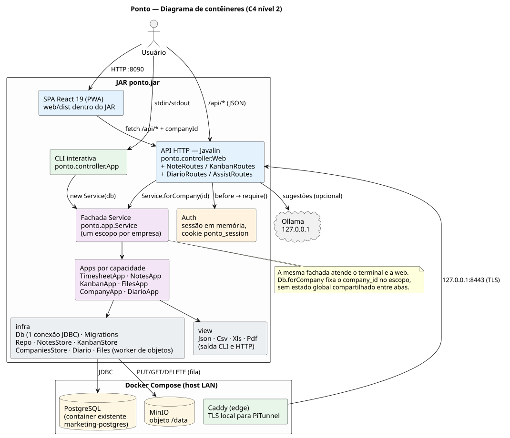
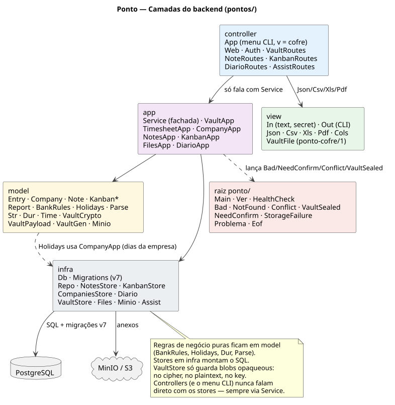

# Arquitetura — visão geral

> ⚠️ Mudou a arquitetura (novo serviço, novo banco, nova integração)? Atualize este arquivo e os diagramas [01](diagramas/01-contexto.puml), [02](diagramas/02-containers.puml) e [03](diagramas/03-backend-camadas.puml) no mesmo PR.

## O que é o Ponto, em uma frase

Um controle de jornada ("cartão de ponto") brasileiro — dia, entrada, saída, justificativa — que funciona **no terminal** e **no navegador**, com PostgreSQL atrás de tudo, distribuído como **um único JAR Java 25**.

## A ideia central que um dev júnior precisa entender

**Um só núcleo, duas portas de entrada.**

```
terminal (menu CLI)  ──┐
                       ├──> Service (fachada) ──> PostgreSQL
navegador (React SPA) ─┘
```

- O código de negócio (calcular saldo, avisar sobre par sobreposto, feriados) mora **uma vez só**, na fachada `ponto.app.Service`.
- O menu do terminal (`controller/App.java`) e a API HTTP (`controller/Web.java`) são apenas "apresentação": formatação, perguntas ao usuário, JSON.
- Por isso qualquer regra nova aparece nos dois lugares de graça — e por isso a regra de ouro: **lógica de negócio nunca vai para controller**.

## Decisões de arquitetura (e o porquê)

| Decisão | Por quê |
|---|---|
| **Monólito em um JAR** | Aplicação pessoal: um comando (`./ponto` ou `./ponto --serve`) roda tudo. Sem rede externa — o calendário de feriados é código (`model/Holidays.java`). |
| **Camadas simples** `controller → app → infra/model` | Fácil de navegar sem container de DI. `Service` é o ponto de composição: ele instancia os apps e os stores. |
| **Uma conexão JDBC, um `lock`** | Todos os escopos de empresa compartilham a mesma conexão e um objeto de trava. Simples e correto para uma pessoa usuária. |
| **`companyId` explícito na web** | Cada aba do navegador lembra a própria empresa (`sessionStorage`) sem mexer na preferência do terminal. O backend cria um escopo `Service.forCompany(id)` por requisição. |
| **Empresas como partições** | Empresa é uma partição dos dados do mesmo usuário, **não** um tenant com autorização independente. O schema garante isso com `company_id` + FKs compostas. |
| **PWA + offline shell** | `web/public/sw.js` cacheia a casca para instalar como app; dados continuam vindo da API quando há rede. |
| **Anexos fora do banco** | Notas e cartões kanban têm arquivos; os metadados ficam em `note_file`/`kanban_card_file` e os bytes vão para MinIO/S3 através de uma fila (`object_job`) com retries. |

## O mapa dos pacotes (backend)

```
src/main/java/ponto/
├── Main.java          # ponto de entrada: --serve, --db, menu, --help
├── controller/        # apresentação: menu CLI, rotas HTTP, Auth
├── app/               # FACHADA Service + apps por capacidade
├── model/             # records + regras puras (Entry, BankRules, Holidays…)
├── infra/             # JDBC, migrações, stores com SQL, MinIO, Ollama
└── view/              # saída: Json (HTTP), Csv/Xls/Pdf, In/Out (terminal)
```

Detalhes em [backend.md](backend.md).

## O mapa do frontend

```
web/src/
├── main.tsx / App.tsx   # rotas, providers, shell (sidebar + abas)
├── api.ts               # único lugar que fala com /api/*
├── Auth.tsx             # login, cookie, guarda RequireAuth
├── Company.tsx          # empresa ativa por aba (sessionStorage)
├── pages/               # uma aba = um arquivo (lazy loading)
└── ui/                  # Confirm, Unsaved, Connection, ícones
```

Detalhes em [frontend.md](frontend.md).

## Diagramas

- Visão macro: 
- Por dentro do JAR e do host: 
- Camadas do backend: 

## Onde cada coisa mora (cheat sheet)

| Quero mudar… | Arquivo(s) | Cuidado com |
|---|---|---|
| Uma regra de saldo/banco de horas | `model/BankRules.java`, `app/TimesheetApp.java` | Testes em `test/` |
| Um endpoint HTTP | `controller/Web.java` ou `controller/*Routes.java` | Atualizar `web/src/api.ts` + `types.ts` |
| Uma página do web | `web/src/pages/*.tsx` | Tipos e textos de acessibilidade |
| Schema do banco | `infra/Migrations.java` | Versão + migração in-place + deploy com snapshot |
| Feriados | `model/Holidays.java` | Não precisa internet — teste no ano seguinte |
| Deploy | `deploy/` | Ler `deploy/README.md` antes |
