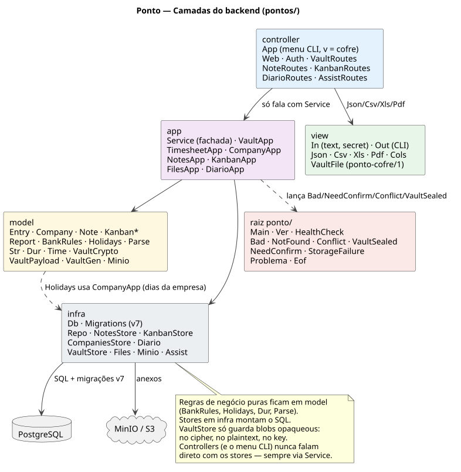
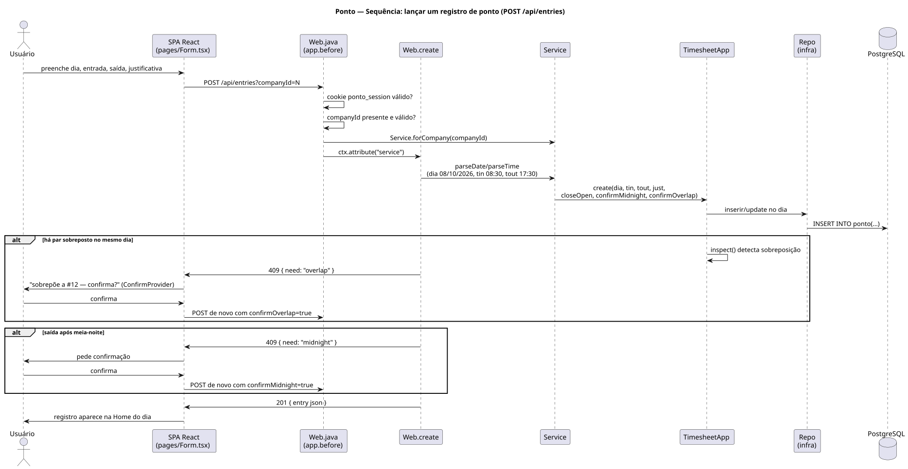
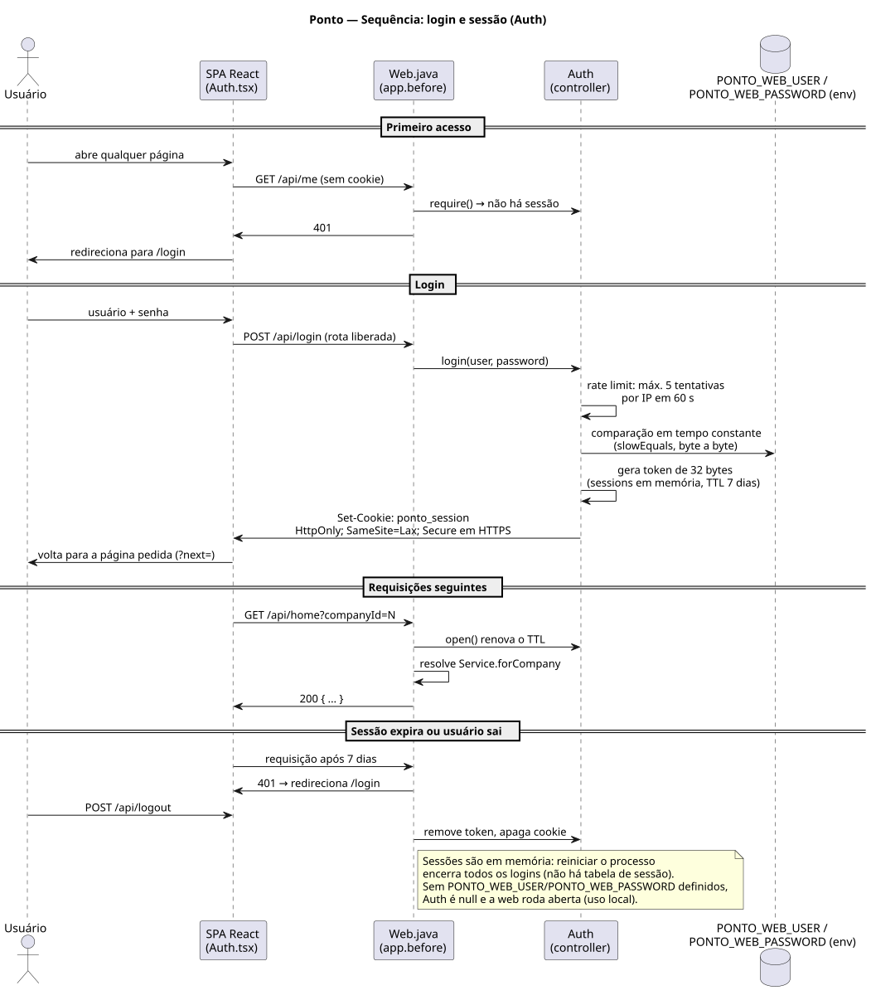
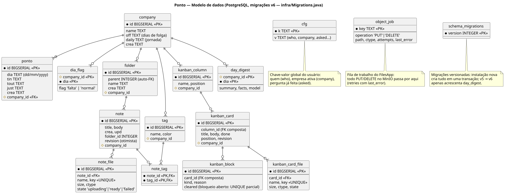

# Backend (Java 25)

> ⚠️ **REGRA**: mudou uma rota, um comportamento de `Service`, o schema ou uma variável de ambiente? Atualize este arquivo e os diagramas [03-backend-camadas](diagramas/03-backend-camadas.puml), [04](diagramas/04-sequencia-lancamento.puml), [05](diagramas/05-sequencia-login.puml) e [07](diagramas/07-er-modelo-dados.puml) **no mesmo PR**.

## Como rodar

```sh
mvn -o package          # JAR gordo em target/ponto.jar
./ponto                 # menu do terminal
./ponto --serve         # API + web em $PONTO_PORT (padrão 8090)
./ponto --check-db      # testa conexão e migrações e sai
```

Requisitos: Java 25, PostgreSQL rodando. Maven só serve para compilar.

## Camadas (e o que pode/deve chamar o quê)



| Pacote | Papel | Regras |
|---|---|---|
| `ponto` (raiz) | `Main` (entrada), `HealthCheck` (usado pelo compose), exceções (`Bad`, `NotFound`, `Conflict`, `NeedConfirm`, `StorageFailure`, `Problema`, `Eof`) e `Ver` (versão) | — |
| `controller` | Menu CLI (`App`), API HTTP (`Web`), `Auth`, rotas por recurso (`NoteRoutes`, `KanbanRoutes`, `DiarioRoutes`, `AssistRoutes`) | **Nunca** fala com `infra` direto — só com `Service`. Nunca contém regra de negócio. |
| `app` | Fachada `Service` + apps por capacidade (`TimesheetApp`, `CompanyApp`, `NotesApp`, `KanbanApp`, `FilesApp`, `DiarioApp`) | Orquestra; valida; lança as exceções de negócio. |
| `model` | Records (`Entry`, `Company`, `Note`, `Kanban*`, `Report`, `Bank`, `Tag`, `Folder`…) e regras puras (`BankRules`, `Holidays`, `Parse`, `Str`, `Dur`, `Time`) | Sem SQL, sem HTTP. Testável isoladamente. |
| `infra` | `Db` (conexão + migrações), stores com SQL (`Repo`, `NotesStore`, `KanbanStore`, `CompaniesStore`, `Diario`), `Files` + `Minio` (anexos), `Assist` (Ollama) | Único lugar com SQL. |
| `view` | `Json`/`Json3` (HTTP), `Csv`/`Xls`/`Pdf` (exportação), `In`/`Out` (terminal) | Formatação, não regra. |

## Ciclo de vida de uma requisição HTTP



1. **`app.before`** (`controller/Web.java`) roda para toda requisição:
   - gera `X-Request-ID`, aplica headers de segurança (CSP, HSTS, nosniff, frame-deny…);
   - em `/api/*` (exceto `/api/health` e `POST /api/login`) exige cookie de sessão (`auth.require()` → 401);
   - exige `companyId` na query (catalogo de empresas e taxonomy são exceção) e cria `Service.forCompany(id)` guardado como atributo da requisição.
2. O handler do endpoint pega `service(ctx)` e delega.
3. Erros de negócio viram JSON: `NeedConfirm` → **409 com `need`** (o frontend pergunta e reenvia com a flag de confirmação), `Conflict`/`NotFound` → 409/404, `Bad` → 400, `Problema` → 400 genérico (mensagem não vaza detalhe), exceção inesperada → 500 com `requestId`.
4. `app.after` força `Cache-Control: no-store` em tudo menos `/assets` (que é imutável, com hash no nome).

### Endpoints principais

| Método e rota | O que faz |
|---|---|
| `GET /api/health` | Saúde: banco, storage, versão, auth — usado pelo Docker |
| `POST/GET/PUT/DELETE /api/login · /api/me · /api/logout` | Sessão |
| `GET /api/home` | Resumo do painel (dia atual, saldo, abertura) |
| `GET/POST /api/entries`, `GET/PUT/DELETE /api/entries/{id}` | Registros de ponto |
| `DELETE /api/days/{dia}`, `PUT /api/days/{dia}/falta · /normal` | Dia inteiro (apagar, falta, "dia normal") |
| `GET /api/day · /api/holiday · /api/bank · /api/sum` | Dia, feriado, banco de horas, resumo |
| `GET /api/export/{kind}` | `pdf` / `xls` / `csv` (anexo) |
| `GET/PUT /api/config` | Nome do usuário, dias de folga, jornada, vacuum |
| `GET/POST/PUT/DELETE /api/companies(…)` | CRUD de empresas + ativação |
| `web/src/api.ts` ↔ `NoteRoutes` / `KanbanRoutes` / `DiarioRoutes` / `AssistRoutes` | Notas, tags, pastas, anexos, kanban, diário, sugestões IA |

**Ao criar ou mudar um endpoint: atualize também `web/src/api.ts` e `web/src/types.ts`** (os tipos TypeScript são espelhados à mão).

## Autenticação (Auth.java)



- Credenciais vêm de `PONTO_WEB_USER` + `PONTO_WEB_PASSWORD` (definidos **juntos**; se nenhum existir, auth é `null` e a web fica aberta — uso local).
- Login: rate limit de 5 tentativas/IP em 60 s, comparação em tempo constante (`slowEquals`), token aleatório de 32 bytes em **memória** (TTL 7 dias, renovado a cada uso).
- Cookie `ponto_session`: `HttpOnly; SameSite=Lax; Secure` quando HTTPS (detectado por `X-Forwarded-Proto`).
- Reiniciar o processo encerra todas as sessões (não há tabela de sessão).
- Logout: remove o token e apaga o cookie.

## Banco de dados



- **Uma conexão JDBC** aberta por `Db.open`; todas as empresas compartilham conexão e `lock`.
- Migrações versionadas em `infra/Migrations.java` (`VERSION = 6`): instalação nova cria o schema completo em uma transação; v5 → v6 apenas acrescenta `day_digest`. Banco de versão mais recente é rejeitado com mensagem clara.
- Tabelas: `company`, `ponto`, `dia_flag`, `cfg`, `folder`, `note`, `tag`, `note_tag`, `note_file`, `kanban_column`, `kanban_card`, `kanban_block`, `kanban_card_file`, `object_job`, `day_digest`, `schema_migrations`.
- Partição por empresa via `company_id` + FKs compostas (ex.: `UNIQUE(id, company_id)`), com trigger garantindo que nota e tag sejam da mesma empresa.
- **Mudou o schema?** Incremente `VERSION`, escreva a migração in-place, e lembre que o deploy usa snapshot e migração de cópia (ver `deploy/README.md`).

## Regras de negócio onde elas moram

| Regra | Onde |
|---|---|
| Datas `dd/mm/yyyy`, horas `NN:NN`, decimais `0.75` | `model/Parse`, `model/Str`, `model/Dur` |
| Feriados Brasil + SP (estado e cidade) | `model/Holidays.java` (código, sem internet) |
| Saldo do mês, plano diário, tolerância | `model/BankRules` + `app/TimesheetApp` |
| Avisos de par sobreposto, virada de meia-noite | `app/TimesheetApp.inspect()` → `NeedConfirm` |
| Relatórios e totais | `model/Report` + `view/Csv|Xls|Pdf` |
| Dias de folga por empresa, jornada diária | `company.off`, `company.daily` (parse em `Service.offDates`/`parseDailyMins`) |

## Anexos (Files + Minio)

- Metadados em `note_file`/`kanban_card_file` (`state`: `uploading → ready | failed`); bytes vão ao MinIO/S3.
- Todo PUT/DELETE passa pela fila `object_job`; o worker de `FilesApp` processa com retries (`attempts`, `last_error`).
- Sem storage configurado, o resto do app funciona; `/api/health` reporta `storage: disabled|ok|unavailable` e `POST /api/storage/retry` força retry.
- Limite de upload: `PONTO_UPLOAD_MIB` (padrão 20 MiB), refletido no `maxRequestSize` do Javalin.

## Diário + IA (opcional)

- `DiarioRoutes` + `app/DiarioApp` geram o resumo do dia (`day_digest`) a partir do ponto, notas e kanban.
- `infra/Assist` fala com Ollama em `127.0.0.1` para sugerir **tags de nota** e **categorias de justificativa**. Sem Ollama: botões não aparecem, nada quebra.

## Variáveis de ambiente

| Variável | Padrão | Efeito |
|---|---|---|
| `PONTO_DB` | `jdbc:postgresql://127.0.0.1:5432/ponto` | JDBC URL (ou `--db=`) |
| `PONTO_PORT` | `8090` | Porta do `--serve` (ou `--port=`) |
| `PONTO_WEB_USER` / `PONTO_WEB_PASSWORD` | — | Login da web (definidos juntos) |
| `PONTO_DATA_DIR` | `~/.local/share/ponto` | Staging de uploads |
| `PONTO_CSV_SEP` | `;` | Separador do CSV (`,` se preferir) |
| `PONTO_UPLOAD_MIB` | `20` | Limite de upload |
| `PONTO_S3_ENDPOINT/ACCESS/SECRET/BUCKET` | — | MinIO/S3 dos anexos |
| `PONTO_TZ` | `America/Sao_Paulo` | Fuso (compose) |
| `PONTO_USER` | — | Nome padrão do usuário (config salva depois em `cfg.who`) |

## Testes

- `test/` — JUnit (configurado no POM, apesar de fora de `src/test/java`), smoke do terminal (`test/smoke.sh`, `feed.txt`), e `test/Verify.java`/`Normal.java` como fixtures.
- Backend roda no CI (`.github/workflows/`) com PostgreSQL provisionado.
- **Mudou uma regra?** Adicione/ajuste o teste junto — e atualize a doc.

## Glossário rápido

- **registro (entry)** — um par entrada/saída de um dia (`ponto`).
- **falta / dia normal** — flags do dia inteiro (`dia_flag`).
- **saldo** — diferença entre o trabalhado e o plano (`bank`).
- **empresa (company)** — partição dos dados; web exige `companyId`.
- **diário (day_digest)** — resumo do dia (ponto + notas + kanban, com IA opcional).
