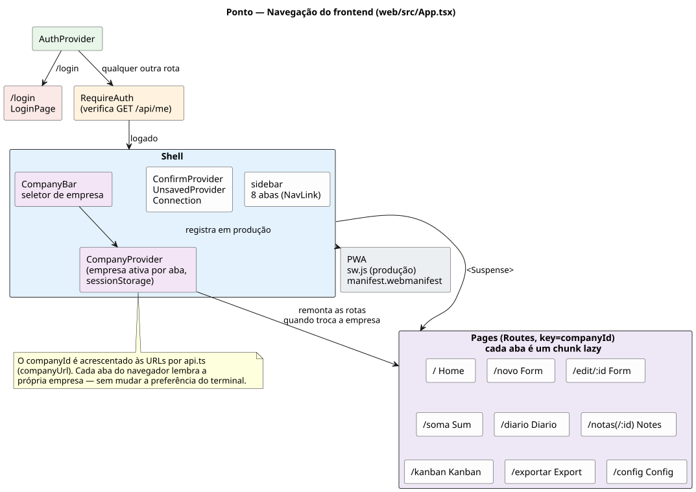
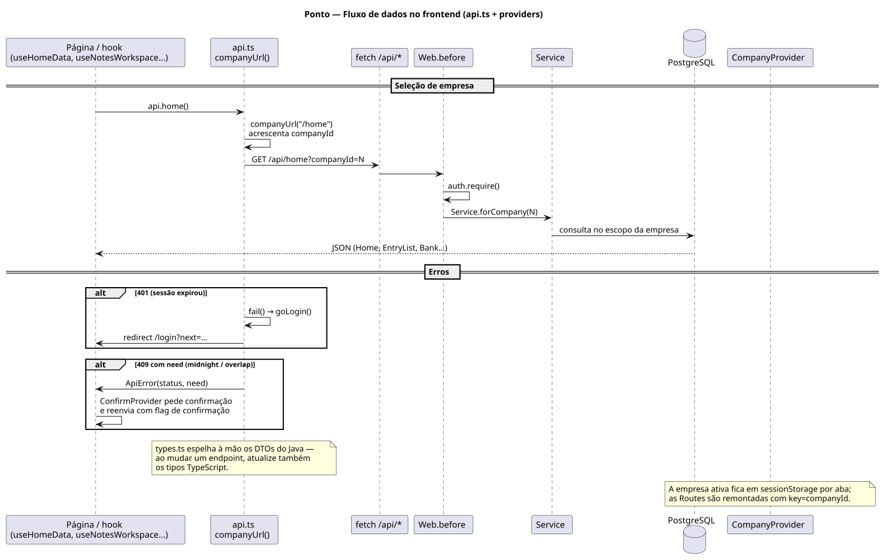

# Frontend (React 19 + Vite + TypeScript)

> ⚠️ **REGRA**: mudou uma página, uma rota, um endpoint chamado ou um tipo? Atualize este arquivo e os diagramas [06-frontend-navegacao](diagramas/06-frontend-navegacao.puml) e [09-fluxo-dados-frontend](diagramas/09-fluxo-dados-frontend.puml) **no mesmo PR**.

## Como rodar

```sh
npm --prefix web ci          # instalar dependências
npm --prefix web run dev     # dev server do Vite
npm --prefix web run test    # Vitest + Testing Library
npm --prefix web run test:e2e# Playwright (Chromium)
npm --prefix web run build   # tsc -b && vite build → web/dist (Maven embute no JAR)
```

O build de produção vai para `web/dist` e o Maven o embute no JAR — o Javalin serve a casca em `/` e os assets com hash em `/assets` (cache imutável).

## Visão geral



```
web/src/
├── main.tsx / App.tsx   # rotas, providers, shell
├── api.ts               # ÚNICO cliente HTTP
├── types.ts             # tipos espelhados dos DTOs Java + ApiError
├── Auth.tsx             # LoginPage, AuthProvider, RequireAuth
├── Company.tsx          # CompanyProvider + CompanyBar (empresa por aba)
├── mask.ts / md.tsx     # máscara de hora NN:NN e markdown
├── justTaxonomy.ts      # categorias de justificativa
├── useAssist.ts         # sugestões IA (opcional, Ollama)
├── vault/              # Cofre: crypto.ts (WebCrypto), model, generator, strength,
│                     #   duplicates, clipboard, session (auto-lock), settings,
│                     #   file.ts (ponto-cofre/1 backup), Vault.tsx (workspace hook)
├── pages/              # 1 aba = 1 chunk lazy
└── ui/                  # Confirm, Unsaved, Connection, Bars, BrandMark
```

### Princípios que guiam o código

1. **Uma aba = um arquivo** (`App.tsx`): carregamento inicial baixa só a casca + a tela aberta; as demais entram como chunks `lazy`.
2. **Todo HTTP passa por `api.ts`**: páginas nunca chamam `fetch` direto.
3. **Toda URL de API leva `companyId`**: `companyUrl()` acrescenta o parâmetro; sem empresa selecionada, ele lança erro amigável.
4. **Providers na ordem certa** (`App.tsx` → `Shell`): `ConfirmProvider > UnsavedProvider > Connection > CompanyProvider > páginas`.
5. **The cofre keeps its key in memory only**: `vault/Vault.tsx` holds the derived `CryptoKey` while the page is open
   and drops it on lock, on navigation and on unmount. The master password and the key never touch `localStorage` or
   `sessionStorage`; only the idle-lock *minutes* are stored (`ponto-cofre-settings`).

## Rotas

| Rota | Página | O que faz |
|---|---|---|
| `/login` | `LoginPage` (`Auth.tsx`) | Login (cookie `ponto_session`) |
| `/` | `pages/Home.tsx` | Painel: dia atual, saldo do mês, atalho de lançamento rápido (`useQuickPunch`) |
| `/novo` e `/edit/:id` | `pages/Form.tsx` | Formulário com máscara `NN:NN` e "Salvar e lançar outra" |
| `/soma` | `pages/Sum.tsx` | Totais por dia, banco de horas, gráfico de 12 meses |
| `/diario` | `pages/Diario.tsx` | Tudo do dia: ponto + notas + kanban + resumo IA |
| `/notas(/:id)` | `pages/Notes.tsx` | Notas com pastas, tags e anexos |
| `/kanban` | `pages/Kanban.tsx` | Colunas e cartões arrastáveis, bloqueios, anexos |
| `/exportar` | `pages/Export.tsx` | PDF/XLS/CSV por período (`exportUrl`) |
| `/config` | `pages/Config.tsx` | Nome, dias de folga, jornada, empresas, storage |
| `/cofre` | `pages/Cofre.tsx` | Password vault: unlock with the master password, one company filter over all companies, generator, copy, auto-lock, sealed backup export/import, rekey |

As `Routes` são remontadas com `key={companyId}` — trocar a empresa remonta as páginas (sem estado velho de outra empresa).

## Fluxo de dados



1. Página/hook chama `api.algumaCoisa()`.
2. `api.ts` monta a URL com `companyId`, `credentials: "include"` (cookie) e `Content-Type: application/json`.
3. Em caso de erro:
   - **401** → `goLogin()` redireciona para `/login?next=<rota atual>`;
   - **409 com `need`** (`midnight`/`overlap`) → `ApiError(status, need)`; o componente pergunta no `ConfirmProvider` e **reenvia com a flag de confirmação** (`confirmMidnight`/`confirmOverlap`);
   - 500 → mensagem com `requestId` para reportar.
4. Resposta validada por tipos de `types.ts` (espelho manual dos DTOs Java — **atualize os dois lados juntos**).

### Empresa ativa por aba

- `CompanyProvider` guarda a empresa em `sessionStorage` — cada aba do navegador lembra a própria escolha.
- O seletor fica no cabeçalho (`CompanyBar`).
- Isso não muda a preferência do terminal (`cfg.company`).

## PWA e offline

- `web/public/sw.js` (registrado **só em produção**, stampado com a versão do build por `tools/stamp-sw.mjs`) cacheia a casca e `/assets/` para instalar como app.
- O SW **não** intercepta `GET /api/*`: um fallback JSON 503 quebrava listagem/download de anexos no HTTPS (PiTunnel); a UI de conexão já cobre offline.
- `manifest.webmanifest` + ícones (`icon-192/512`, apple-touch).
- Service worker exige contexto seguro: HTTPS ou `localhost`; HTTP simples de LAN serve a interface sem instalar.
- **Cofre** também exige contexto seguro: em HTTP da LAN o browser não expõe `crypto.subtle` e a tela avisa para abrir via HTTPS (túnel) ou localhost — a mensagem antiga que culpava o browser era falsa.
- Sem rede a casca abre, mas os dados pedem conexão — o `ui/Connection` avisa.

## UX que vale saber

- **Máscara de hora** (`mask.ts`): só dígitos; digitar `830` vira `08:30`; botão **agora** preenche o relógio.
- **Salvar e lançar outra** (`Form.tsx`): mantém o dia em tela para registrar vários pares sem reabrir.
- **Sobrescrever um par** (`Unsaved`/`Confirm`): o backend devolve 409 com `need`, o frontend pede confirmação e reenvia.
- **Acessibilidade**: skip-link (`#conteudo`), `aria-label`/`aria-expanded` no menu, navegação por teclado no grid de notas.

## Testes

- **Vitest + Testing Library** (`web/test/`): hooks e componentes puros (máscara, árvore de notas, busca) and the
  whole `vault/` layer. jsdom's `crypto` is replaced by Node's `webcrypto` in `vitest.config.ts`, because the vault
  needs real AES-GCM — a mock would prove nothing. `test/vault-node.mjs` (the repo's third implementation) is read
  straight from `process.cwd()/..` so the browser code is checked against the same bytes the Java tests check.
- **Playwright** (`web/e2e/`, `playwright.config.ts`): fluxo ponta a ponta no Chromium; requer `npx playwright install chromium`.
- Rodam no CI junto com o backend (`.github/workflows/`).
- **Mudou um fluxo visível?** Atualize o teste E2E correspondente no mesmo PR.

## Glossário frontend

- **casca (shell)** — `index.html` + assets: o que o service worker cacheia.
- **chunk lazy** — código de uma aba que só baixa quando a aba abre.
- **`need`** — campo de um 409 que diz qual confirmação o backend espera (`midnight` ou `overlap`).
- **`next`** — query da página de login para voltar à rota original após logar.
